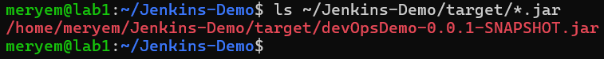
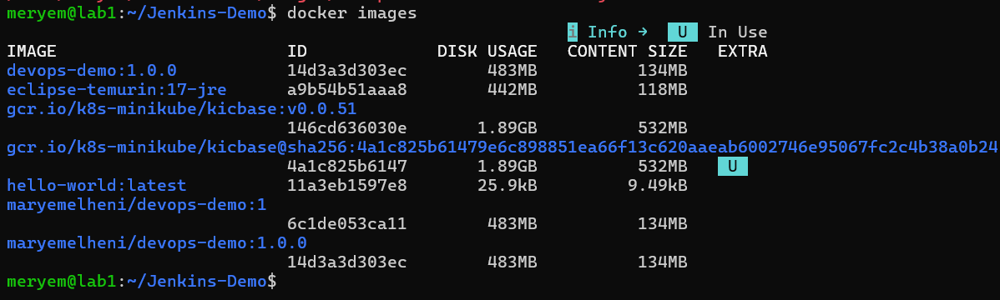
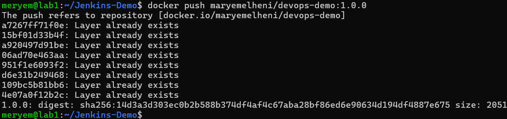
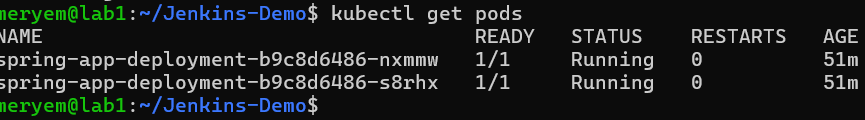
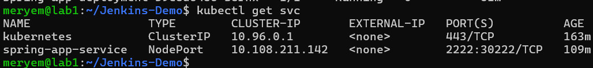
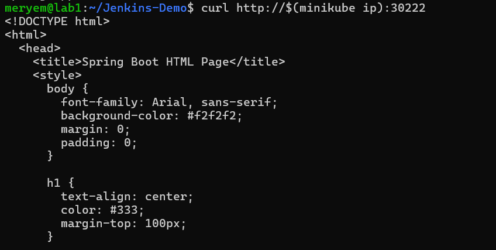

# Lab 1 - CI/CD avec Jenkins

**Étudiante :** Meryem Elheni
**Cours :** Jenkins CI/CD Pipeline (Formateur : Wahid Hamdi)

## Objectif

Déployer une application Spring Boot dans Kubernetes (Minikube), d'abord manuellement, puis automatiquement avec Jenkins.

## Environnement

- Ubuntu 26.04 Server (VM VMware)
- Docker, Minikube, kubectl
- Java 17, Maven
- Jenkins 2.580.1

## Partie I : Déploiement manuel (sans Jenkins)

### 1. Compilation du projet

Le projet Spring Boot est compilé avec Maven. L'application écoute sur le port **2222** (`server.port=2222`).

```bash
mvn clean install
```



### 2. Création de l'image Docker

Dockerfile utilisé :

```dockerfile
FROM eclipse-temurin:17-jre
EXPOSE 2222
WORKDIR /app
COPY target/devOpsDemo-0.0.1-SNAPSHOT.jar app.jar
CMD ["java", "-jar", "app.jar"]
```

```bash
docker build -t devops-demo:1.0.0 .
```



### 3. Envoi sur Docker Hub

```bash
docker tag devops-demo:1.0.0 maryemelheni/devops-demo:1.0.0
docker push maryemelheni/devops-demo:1.0.0
```



### 4. Déploiement sur Kubernetes (Minikube)

`deployment.yaml` (2 réplicas) :

```yaml
apiVersion: apps/v1
kind: Deployment
metadata:
  name: spring-app-deployment
spec:
  replicas: 2
  selector:
    matchLabels:
      app: spring-app
  template:
    metadata:
      labels:
        app: spring-app
    spec:
      containers:
        - name: spring-app-container
          image: maryemelheni/devops-demo:1.0.0
          ports:
            - containerPort: 2222
```

`service.yaml` (type NodePort) :

```yaml
apiVersion: v1
kind: Service
metadata:
  name: spring-app-service
spec:
  selector:
    app: spring-app
  ports:
    - protocol: TCP
      port: 2222
      targetPort: 2222
  type: NodePort
```

```bash
kubectl apply -f deployment.yaml
kubectl apply -f service.yaml
```





### 5. Test de l'application

```bash
curl http://$(minikube ip):30222
```



**Remarque :** le PDF du cours utilise le port 8080 dans les fichiers YAML, mais l'application écoute sur 2222. J'ai donc utilisé 2222 partout.
