# Lab 1 - CI/CD avec Jenkins

**Étudiante :** Meryem Elheni
**Cours :** Jenkins CI/CD Pipeline (Formateur : Wahid Hamdi)

## Objectif

Déployer une application Spring Boot dans Kubernetes (Minikube), d'abord manuellement, puis automatiquement avec Jenkins.

## Environnement

- Ubuntu 26.04 Server (VM VMware)
- Docker, Minikube, kubectl
- Java 17, Maven
- Jenkins 2.580.1

## Partie I : Déploiement manuel (sans Jenkins)

### 1. Compilation du projet

Le projet Spring Boot est compilé avec Maven. L'application écoute sur le port **2222** (`server.port=2222`).

```bash
mvn clean install
```


### 2. Création de l'image Docker

Dockerfile utilisé :

```dockerfile
FROM eclipse-temurin:17-jre
EXPOSE 2222
WORKDIR /app
COPY target/devOpsDemo-0.0.1-SNAPSHOT.jar app.jar
CMD ["java", "-jar", "app.jar"]
```

```bash
docker build -t devops-demo:1.0.0 .
```


### 3. Envoi sur Docker Hub

```bash
docker tag devops-demo:1.0.0 maryemelheni/devops-demo:1.0.0
docker push maryemelheni/devops-demo:1.0.0
```


### 4. Déploiement sur Kubernetes (Minikube)

`deployment.yaml` (2 réplicas) :

```yaml
apiVersion: apps/v1
kind: Deployment
metadata:
  name: spring-app-deployment
spec:
  replicas: 2
  selector:
    matchLabels:
      app: spring-app
  template:
    metadata:
      labels:
        app: spring-app
    spec:
      containers:
        - name: spring-app-container
          image: maryemelheni/devops-demo:1.0.0
          ports:
            - containerPort: 2222
```

`service.yaml` (type NodePort) :

```yaml
apiVersion: v1
kind: Service
metadata:
  name: spring-app-service
spec:
  selector:
    app: spring-app
  ports:
    - protocol: TCP
      port: 2222
      targetPort: 2222
  type: NodePort
```

```bash
kubectl apply -f deployment.yaml
kubectl apply -f service.yaml
```


### 5. Test de l'application

```bash
curl http://$(minikube ip):30222
```


**Remarque :** le PDF du cours utilise le port 8080 dans les fichiers YAML, mais l'application écoute sur 2222. J'ai donc utilisé 2222 partout.

## Partie II : Jenkins Freestyle

Jenkins est accessible sur `http://192.168.65.138:8080`. Il tourne avec Java 21 (exigé par la version 2.580.1), alors que le projet utilise Java 17.

### Étape 1 : Job `freestyle_demo`

Création d'un projet free-style nommé `freestyle_demo` avec une étape de build « Exécuter un script shell » :

```bash
echo 'Bonjour'
ls -l
echo 'Bonjour DevOps' > test.txt
ls -l
```

Le fichier `test.txt` est créé dans `/var/lib/jenkins/workspace/freestyle_demo`.

### Étape 2 : Exécution de Test.java

Un fichier `Test.java` qui affiche « Hi Master DevOps » est placé dans le workspace, et la commande `java Test.java` est ajoutée au script.

```java
public class Test {
    public static void main(String[] args) {
        System.out.println("Hi Master DevOps");
    }
}
```

### Étape 3 : Script récupéré depuis GitHub

Le job est lié au dépôt `https://github.com/meryemelheni/jenkins-freestyle.git` (section **Gestion de code source**, branche `*/main`). Le dépôt contient `script.sh` et `Test.java`. L'étape de build devient :

```bash
sh script.sh
```

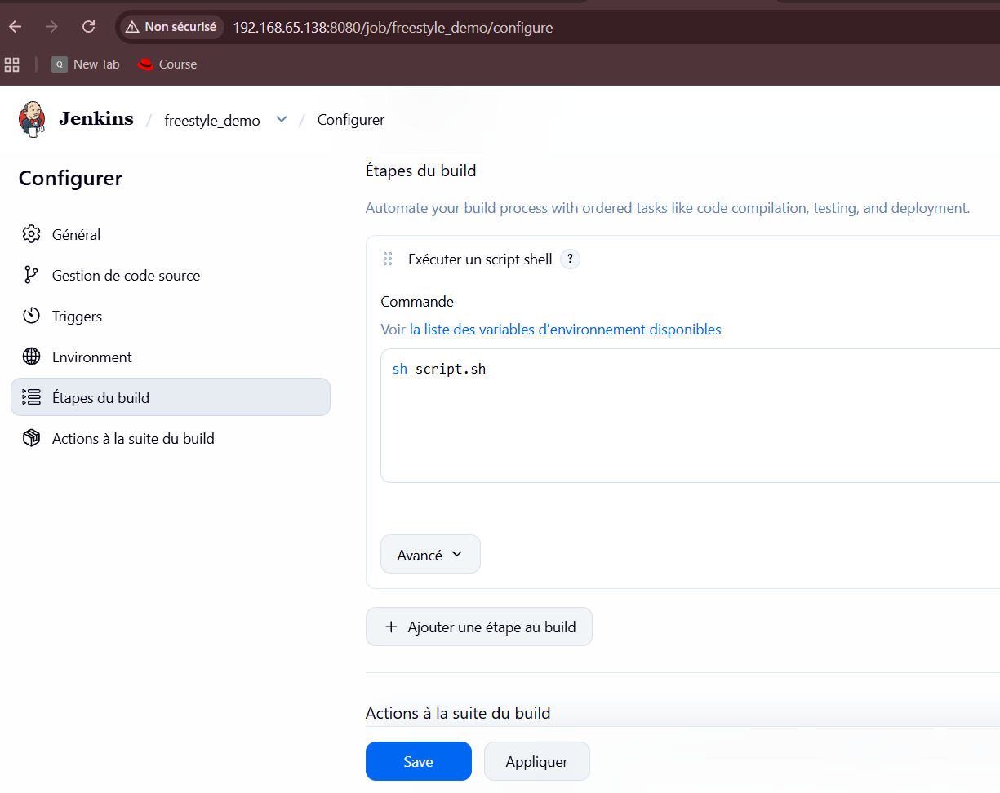

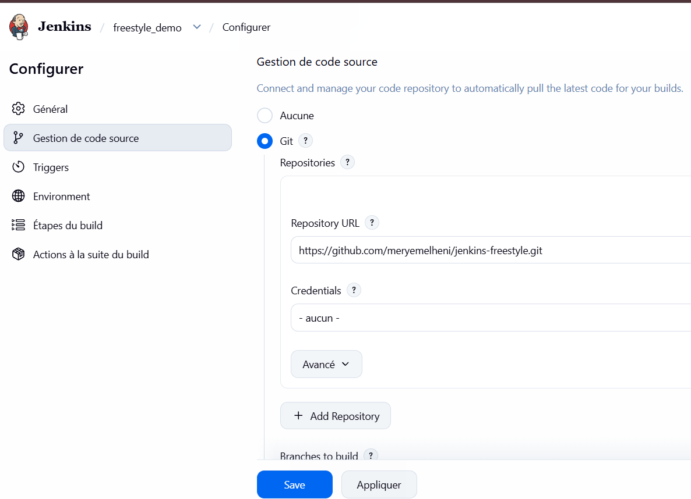

La console montre le clonage du dépôt, l'exécution du script et le résultat `Hi Master DevOps` :

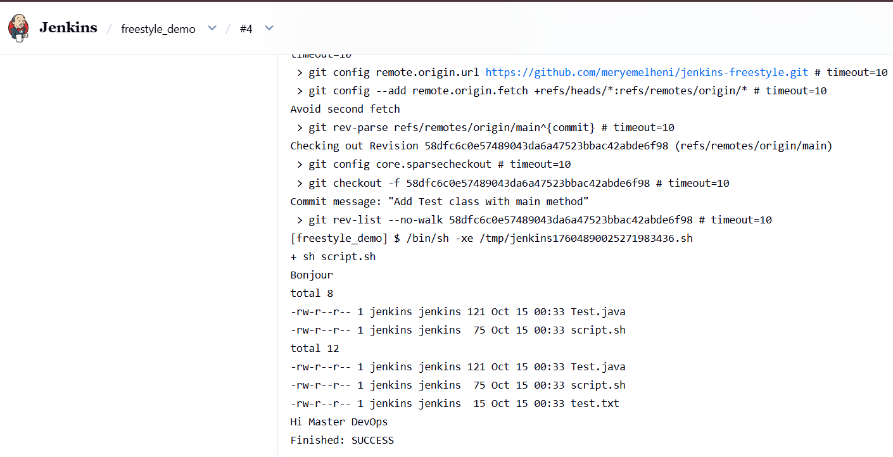

### Étape 4 : Déclenchement automatique et rétention

- **Construire périodiquement** avec le planning `H/5 * * * *` : un build toutes les 5 minutes.
- **Supprimer les anciens builds** : seuls les 2 derniers builds sont conservés.
- **Supprimer le workspace avant le démarrage du build** : le dossier est vidé à chaque lancement.

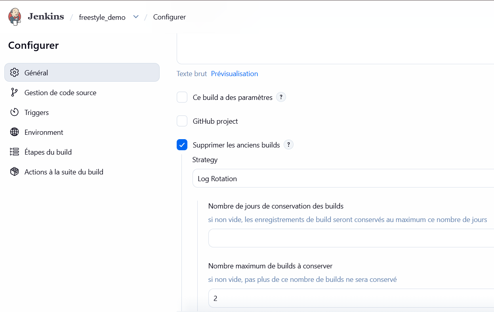

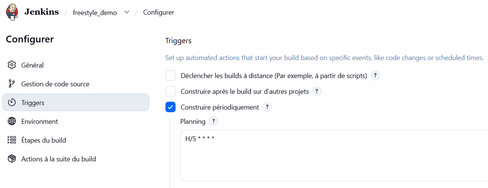

L'historique ne contient que 2 builds :

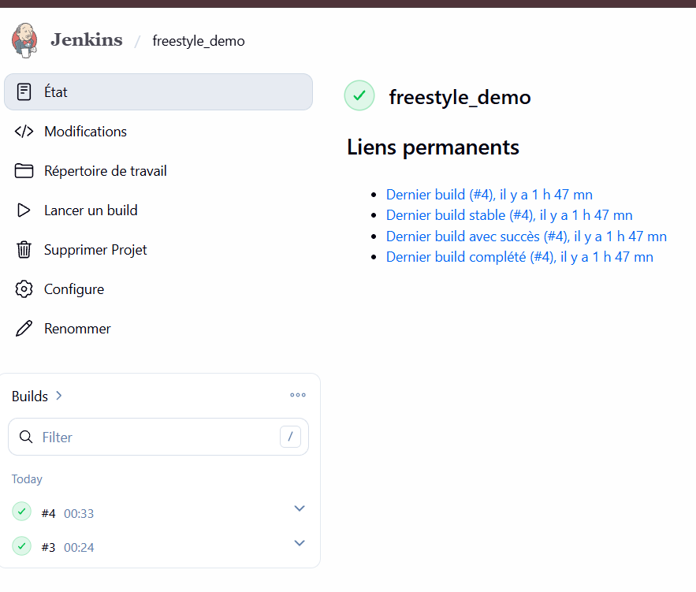


### Étape 5 : Challenge, déploiement automatique sur Kubernetes

Un job free-style `deploy_springboot` automatise toute la chaîne de la Partie I : compilation, image Docker, envoi sur Docker Hub, déploiement sur Kubernetes.

**Code source :** le job clone `https://github.com/wahid007/Jenkins-Demo.git`.

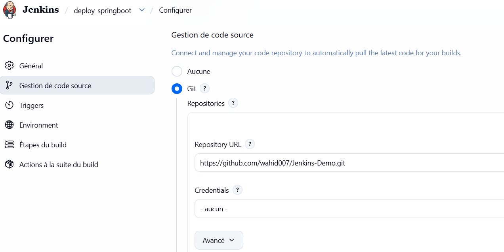

**Identifiants Docker Hub :** le mot de passe n'est pas écrit dans le script. Il est stocké dans les Credentials Jenkins (ID `dockerhub`) et injecté par les variables `DOCKER_USER` et `DOCKER_PASS`.

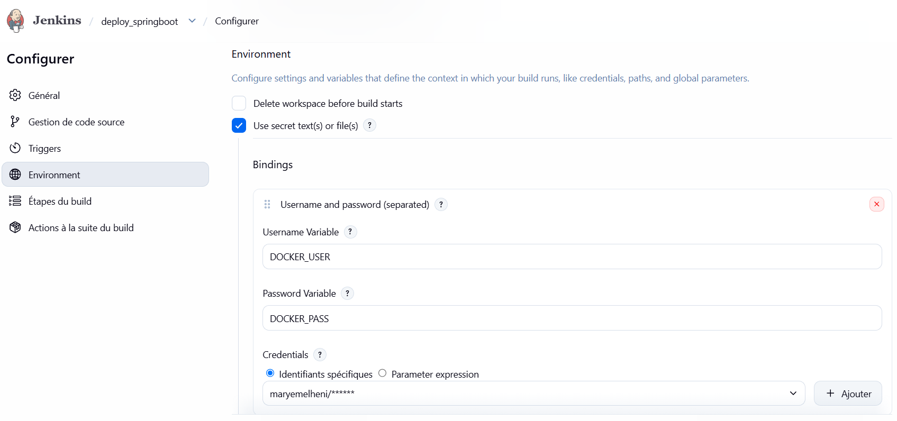

**Script de build :**

```bash
set -e

IMAGE=maryemelheni/devops-demo
TAG=$BUILD_NUMBER

# 1. Build Maven
mvn clean install -DskipTests

# 2. Dockerfile
cat > Dockerfile << 'EOF'
FROM eclipse-temurin:17-jre
EXPOSE 2222
WORKDIR /app
COPY target/devOpsDemo-0.0.1-SNAPSHOT.jar app.jar
CMD ["java", "-jar", "app.jar"]
EOF

# 3. Build de l'image
docker build -t $IMAGE:$TAG .

# 4. Push sur Docker Hub
echo "$DOCKER_PASS" | docker login -u "$DOCKER_USER" --password-stdin
docker push $IMAGE:$TAG

# 5. Fichiers Kubernetes
cat > deployment.yaml << EOF
apiVersion: apps/v1
kind: Deployment
metadata:
  name: spring-app-deployment
spec:
  replicas: 2
  selector:
    matchLabels:
      app: spring-app
  template:
    metadata:
      labels:
        app: spring-app
    spec:
      containers:
        - name: spring-app-container
          image: $IMAGE:$TAG
          ports:
            - containerPort: 2222
EOF

cat > service.yaml << 'EOF'
apiVersion: v1
kind: Service
metadata:
  name: spring-app-service
spec:
  selector:
    app: spring-app
  ports:
    - protocol: TCP
      port: 2222
      targetPort: 2222
  type: NodePort
EOF

# 6. Déploiement
kubectl apply -f deployment.yaml
kubectl apply -f service.yaml
kubectl rollout status deployment/spring-app-deployment --timeout=180s
kubectl get pods
kubectl get svc
```

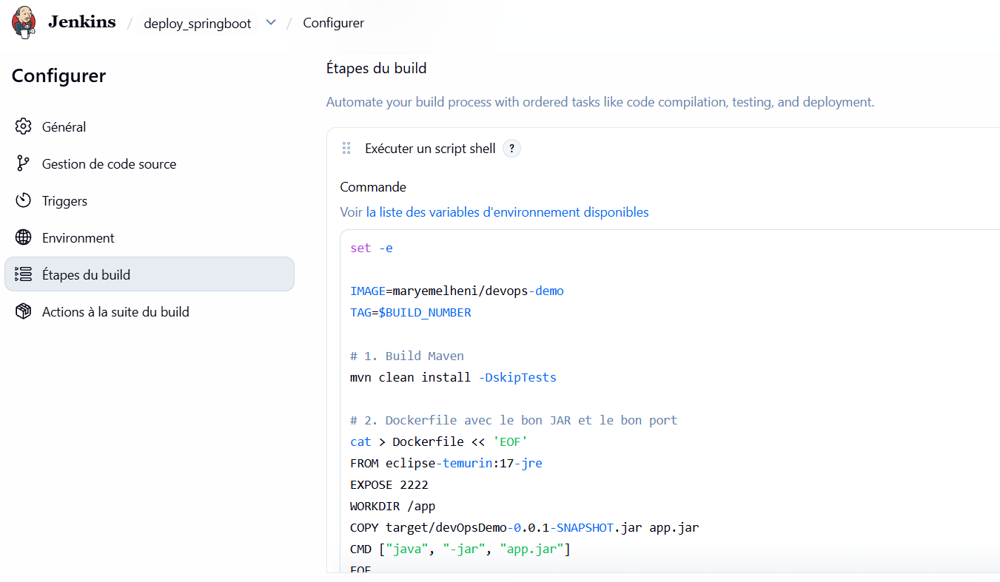

**Résultat :** les 2 pods tournent avec l'image `maryemelheni/devops-demo:1`. Le tag `1` correspond au numéro du build Jenkins, alors que le déploiement manuel utilisait `1.0.0` : cela prouve que le déploiement vient de Jenkins.

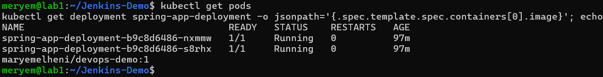

L'application répond :

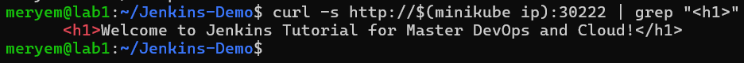

## Conclusion

Ce lab m'a permis de déployer une application Spring Boot dans Kubernetes d'abord à la main, puis de tout automatiser avec Jenkins.

Points importants :

- **Ports :** l'application écoute sur **2222** (`server.port=2222`), alors que le PDF du cours utilise 8080 dans les YAML. J'ai utilisé 2222 partout.
- **Tag `$BUILD_NUMBER` :** avec un tag fixe, Kubernetes ne redéploie rien. Avec un tag différent à chaque build, il fait une mise à jour progressive (rolling update).
- **Sécurité :** le mot de passe Docker Hub est dans les Credentials Jenkins et non dans le script.
- **Java :** Jenkins 2.580.1 exige Java 21, alors que le projet utilise Java 17. J'ai donc configuré Jenkins avec Java 21 (`JAVA_HOME`) et gardé Java 17 pour le projet.
- **Accès Kubernetes :** l'utilisateur `jenkins` a son propre fichier kubeconfig pour piloter Minikube.
